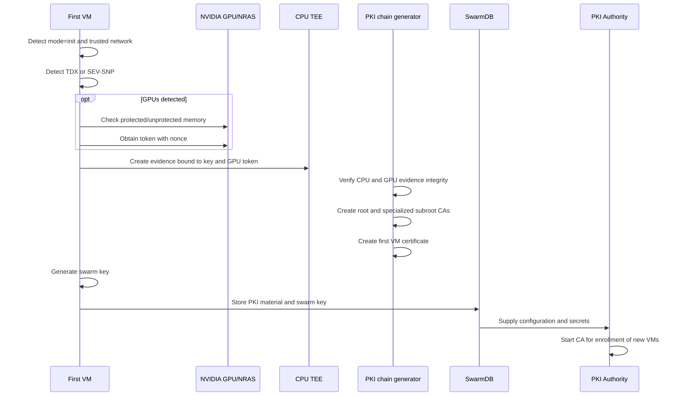

# 2. First Virtual Machine Bootstrap

## Initial State

The first VM starts in `init` mode and initializes SwarmDB and the PKI
infrastructure for a new Swarm.

To select this mode, the following fields in `/sp/swarm/config.yaml` must be
empty:

- `swarm_db.join_addresses: []` — no existing SwarmDB nodes;
- `pki_authority.caBundle: ""` — no root CA of an existing Swarm;
- `pki_authority.servers: []` — no existing PKI Authority endpoints.

An omitted field or a field with a `null` value is treated as empty. The
explicit empty values below show the expected field types.

The relevant configuration fragment is:

```yaml
swarm_db:
  join_addresses: []

pki_authority:
  caBundle: ""
  servers: []
```

All three fields must be empty simultaneously. The mode detector then writes
`init` to `/etc/swarm/swarm-vm-mode`.

`swarm_db.bootstrap: true` declares that this VM is allowed to create a Swarm.
It is optional for compatibility with configurations written before it existed,
and `swarm_db.bootstrap: false` turns the empty combination above into a
configuration error. See `detect_swarm_pki_state` in
`src/rootfs/files/configs/pki-service/scripts/pki_configure_helper.py`.

## Attestation mode

`attestation.mode` selects where Intel TDX collateral comes from. The same
section is required on the first VM and on every VM that joins. An omitted
section means `online`.

```yaml
attestation:
  mode: offline
  tdx:
    pccsUrl: https://pccs.site.internal:8081/sgx/certification/v4/
    pccsCaPem: |
      -----BEGIN CERTIFICATE-----
      ...
      -----END CERTIFICATE-----
```

`online` keeps the in-guest PCCS and ignores `attestation.tdx`. `offline`
requires both `pccsUrl` and `pccsCaPem`. `tdx-collateral.service` rewrites
`/etc/sgx_default_qcnl.conf` to that URL, trusts the given CA, and does not
start `pccs.service`. There is no fallback to localhost or to Intel.

Before either PKI unit starts, `get-vm-mode` runs
`pki-cert-generator get-attestation-type` when the mode is `offline`. The only
accepted result is `tdx`. `tdx-azure`, `tdx-google`, `sev-snp`,
`sev-snp-azure`, and `untrusted` fail the unit and no certificate is issued.
`online` does not move that check into `get-vm-mode`.

## Sequence



## 1. Detecting the Hardware Environment

The CPU TEE type is detected by `pki-cert-generator get-attestation-type`, in
this order:

1. An Azure confidential VM is identified first, without any network
   request. Azure CVMs run behind a Microsoft paravisor, so the guest has no
   usable TEE device and `/proc/cpuinfo` carries no TEE flags. Instead:
   - the DMI chassis asset tag
     (`/sys/class/dmi/id/chassis_asset_tag`) equals
     `7783-7084-3265-9085-8269-3286-77`, which marks an Azure VM;
   - the Hyper-V isolation type (CPUID leaf `0x4000000C`, `EBX & 0xF`, read
     through `/dev/cpu/0/cpuid` after checking the `Microsoft Hv` signature
     at leaf `0x40000000`) names the TEE: `3` is TDX, `2` is SEV-SNP. This is
     the value the Linux kernel itself uses.

   Isolation type TDX selects `tdx-azure`, SEV-SNP selects `sev-snp-azure`.
   This check runs before the device checks because on Azure the isolation
   type takes precedence over any `/dev/sev-guest`.
2. Character device `/dev/tdx_guest` identifies Intel TDX. A Google IMDS
   request to `http://169.254.169.254/computeMetadata/v1/instance/id` with
   header `Metadata-Flavor: Google` and a 500 ms timeout selects
   `tdx-google` when it returns a non-empty instance ID; otherwise the type
   is `tdx`.
3. Character device `/dev/sev-guest` identifies AMD SEV-SNP (`sev-snp`). On
   GCP, detected by the same IMDS request, SEV-SNP is not supported and the
   type is `untrusted`.
4. Otherwise the type is `untrusted`, and no certificate for a trusted network
   can be issued.

`tdx-azure` and `sev-snp-azure` are not aliases of `tdx-google` or `sev-snp`.
Azure evidence is produced through the vTPM rather than a TEE guest driver;
its format and verification are described in
[chapter 8](08-azure-attestation.md).

The detected CPU type is written to `/etc/swarm/swarm-cpu-type`.

In `offline` mode this detection also runs from `get-vm-mode`, on the first VM
and on a joining VM, and anything other than `tdx` stops the boot. Cloud
platforms are not given a local collateral URL.

## 2. Creating Keys and the Challenge

When the VM has GPUs, GPU evidence is prepared before CPU evidence is created:

1. GPUs exposing unprotected memory are rejected;
2. a random nonce is generated;
3. an NVIDIA token is obtained;
4. SHA-256 is calculated over the serialized NVIDIA token;
5. the public-key hash and token hash are combined in CPU `reportData`.

The CPU quote/report therefore attests the VM environment, certificate key,
and the specific GPU token together.

## 3. Local Evidence Verification

Before creating the certificates, the generator verifies the hardware
evidence:

- for TDX (`tdx`, `tdx-google`), it verifies the DCAP quote and event-log
  integrity;
- for Azure (`tdx-azure`, `sev-snp-azure`), it verifies the vTPM evidence and
  the Microsoft Azure Attestation verdict as described in
  [chapter 8](08-azure-attestation.md);
- for SEV-SNP, it verifies report authenticity and the required platform
  security properties, and reproduces the launch measurement;
- when a GPU is present, it verifies token binding, the NVIDIA verification
  results, and the absence of debug mode;
- the public-key hash in the verified `reportData` must match the key of the
  certificate being created.

This local verification confirms the cryptographic correctness and hardware
integrity of the reports. It does not compare the first VM's `mrEnclave` with
the trusted registry. Joining nodes perform that registry check later, before
accepting the root CA.

## 4. Creating the PKI

A root CA and two specialized subroot CAs are created:

- device enrollment;
- evidence signing.

A first-VM certificate signed by the device subroot is also created. The full
hierarchy is described in the [PKI chapter](06-pki.md).

The root certificate contains:

- the challenge type;
- `networkType=trusted`;
- serialized CPU TEE evidence.

The first-VM certificate also contains the challenge metadata and CPU evidence,
as well as verified GPU information when a GPU is present.

The certificate fields and their OIDs are described in
[Certificate Extensions and OIDs](06-pki.md#certificate-extensions-and-oids).

## 5. Creating and Storing the `swarm key`

The first VM generates one random 32-byte value, represented by 64 hexadecimal
characters. The file:

```text
/etc/swarm/swarm.key
```

is created with mode `0600` and is not overwritten.

After local SwarmDB starts, the bootstrap procedure stores:

- root and subroot certificates;
- their private keys;
- the `swarm key`, as `pki_swarm_key`;
- the evidence-signing key.

PKI material is stored as `SwarmSecrets`
(`src/swarm-scripts/00-initialize-secrets.sh:101-158`). Existing rows are never
overwritten. After a successful import, `/etc/super/certs/swarm-init` is
removed.

## 6. Starting the PKI Authority

When PKI Authority starts, it obtains the PKI material and `swarmKey` from
`SwarmSecrets` and reads its settings from `/sp/swarm/config.yaml`:

- `networkType: trusted`;
- `networkID` from `pki_authority.networkID`;
- allowed attested device types: `tdx`, `tdx-google`, `tdx-azure`, `sev-snp`,
  and `sev-snp-azure`.

`networkID` is not a secret. It identifies the Swarm in the PKI enrollment
protocol and prevents two clusters from being mixed accidentally. The value is
provided through the configuration and must be the same on every VM in that
Swarm; PKI Authority does not generate it. A challenge carrying a different
`networkID` is not accepted.

PKI Authority exposes its HTTPS endpoint on port `9443`. Its TLS configuration
and root CA retrieval are described in
[PKI Endpoint](06-pki.md#pki-endpoint).

After startup, the PKI Authority on the first VM becomes the enrollment point
for new nodes. Its addresses and CA bundle must be passed to joining VMs
together with the existing SwarmDB addresses.

## Rebooting the First VM

Nothing the `init` path writes survives a reboot. The encrypted state disk is
reformatted with a fresh random key on *every* boot
(`src/initramfs/files/init.sh:243-252`), so `/etc/swarm/swarm.key`,
`/etc/super/certs/swarm-init/` and the node's certificate in
`/etc/super/certs/vm/` are all gone when the VM comes back.

The provider configuration is the only durable input a VM has, and it is what
decides the mode. A first VM whose configuration still selects `init` therefore
bootstraps a *second*, unrelated Swarm on its own hardware:
`pki-cert-init.service` runs again
(`src/rootfs/files/configs/pki-service/systemd/pki-cert-init.service:11-21`),
`generate_swarm_key` creates a new `swarm key` because the file is missing
(`pki_configure_helper.py:587-611`), and `pki-cert-generator generate-chain`
creates a new root, new subroots and a new VM certificate. The consequences:

- its SwarmDB uses a gossip encryption key no other member has, so it cannot
  rejoin the ring it created, and nothing can bootstrap through it either;
- its node certificate is signed by a subroot no other member trusts;
- a PKI Authority running on it would hand the new `swarm key` to every
  joining VM while the existing members keep the old one.

**Before the first VM is rebooted, its provider configuration must name the
Swarm it created** — `swarm_db.join_addresses`, `pki_authority.caBundle` and
`pki_authority.servers` of the other members. With those present the mode is
`normal` regardless of `swarm_db.bootstrap`, so the VM enrols like any other
node: it keeps the original chain, pulls the original `swarm key` from a PKI
Authority and rejoins the ring.

`scripts/azure/cluster.sh` does this automatically. As soon as a second node
serves the cluster CA, `promote_bootstrap_config` re-renders the first VM's
provider configuration as a join configuration and re-uploads it; `cluster.sh
refresh-configs` keeps it so. On other platforms the operator performs the same
edit.

A single-node Swarm has no second member to enrol from, so its one VM cannot be
rebooted without losing the Swarm. `cluster.sh` says so when it cannot promote
the configuration.

## Bootstrap Result

Bootstrap is complete when the following exist:

- a trusted-network root CA containing CPU TEE evidence;
- device and evidence subroot CAs;
- the `swarm key`;
- SwarmDB containing PKI secrets and network state;
- a running PKI Authority.

## When Bootstrap Fails

Every step above runs as a systemd unit that `multi-user.target` waits for, so
each one of them can keep a VM in boot. The units that can fail for a reason
outside the VM — a provider archive that is gone, a PKI chain that cannot be
built, a release asset that cannot be downloaded — therefore make **one bounded
attempt per start** and leave the retry to systemd (`Restart=on-failure`,
`RestartSec`, `StartLimitIntervalSec=0`):

| Unit | Attempt bounded at | `TimeoutStartSec` | Retried every |
|---|---|---|---|
| `provider-config.service` | — | default | 60 s |
| `pki-vm-mode.service` | 180 s (waits 120 s for `/sp`) | 240 s | 30 s |
| `pki-cert-init.service` | 240 s | 300 s | 60 s |
| `swarm-init.service` | 600 s | 660 s | 30 s |
| `pki-authority-sync.service` | 240 s | 300 s | 60 s |

The VM reaches `multi-user.target` either way, which is the point: a node that
cannot bootstrap stays reachable and says why instead of sitting in a start job
forever with its HTTP port answering (SUP-370).

Each attempt publishes its verdict to `/run/sp-health/<unit>.json` — `state`
(`attempting` / `ok` / `failed`), the attempt number, the exit code, a stable
`reason_class`, and a pointer to that attempt's log. `/run` is tmpfs, so a
reboot cannot leave a node looking initialised before it has initialised again.

A failure is also written to `/dev/console`, naming what stays down and the tail
of the attempt's own output. On a `-release` image there is no SSH and no
readable journal, so the console is the only channel left. The block is
rate-limited — full for the first three attempts, again whenever the failure
changes kind, then hourly, with a one-line reminder in between — because both
Azure boot diagnostics and nova `console-log` keep only a bounded tail, and an
unthrottled diagnostic would evict the original boot output. Key material is
stripped out of that tail by shape: whole PEM blocks are suppressed, base64
tokens are suppressed, and hex tokens keep a short head so a CA fingerprint
stays comparable against the authority's. GitHub tokens are matched by prefix
instead (`ghp_`/`gho_`/`ghu_`/`ghs_`/`ghr_`, `github_pat_`), because the
underscore breaks the run a length rule looks for — `swarm-init` is the unit
that carries `github.token`, and `/dev/console` on a confidential VM is outside
the TEE boundary.

When a later attempt succeeds, the unit starts the services whose boot-time
start jobs died with it (`ExecStartPost`): a failed dependency leaves them with
no start job at all, and `Restart=` cannot revive a unit that never started.

Each unit starts only the dependents nobody else will revive, so the chain
cascades: `pki-vm-mode` → `pki-cert-init` and `pki-authority-sync` →
`swarm-init` → `swarm-db`, `swarm-host-agent`, `swarm-node`, `swarm-services`.
Exactly one of `pki-cert-init` / `pki-authority-sync` applies to a given node;
the other is skipped by its `ExecCondition`, and **a condition-skipped unit's
`ExecStartPost` does not run**. So the cascade takes a different route on each
role:

- **Seed** (`vm-mode` = `init`): `pki-cert-init` runs and starts `swarm-init`
  directly. `pki-authority-sync` is the skipped one.
- **Worker** (`vm-mode` = `normal`): `pki-cert-init` is skipped, so nothing
  starts `swarm-init` by name. It is pulled in instead by
  `swarm-db.service`, which `Requires=swarm-init.service` and is started by
  `pki-authority-sync`'s `ExecStartPost`.

The worker route is indirect and therefore worth knowing about: it is why
`pki-vm-mode` does not need to name `swarm-init` itself, and it is the line to
check first if a worker ever recovers its PKI but not its swarm services.
