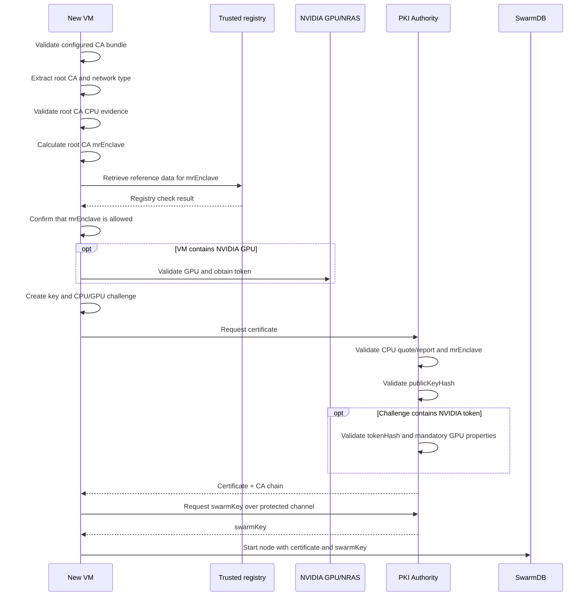

# 3. Joining a Subsequent Virtual Machine

## Input

A joining VM must receive a consistent set of parameters:

```yaml
swarm_db:
  join_addresses:
    - "10.0.0.10:3306"

pki_authority:
  caBundle: |
    -----BEGIN CERTIFICATE-----
    ...
    -----END CERTIFICATE-----
  servers:
    - "10.0.0.10:9443"
```

The values illustrate the structure only. Actual addresses and certificates
are supplied by the environment operator. When all three field groups are
populated, the VM selects `normal` mode. SwarmDB addresses are also used as
additional PKI endpoints on port `9443` when their hosts are not already
listed in `pki_authority.servers`.

## Join Sequence



## 1. Root CA Verification Before Enrollment

The self-signed root certificate is extracted from `caBundle`. Providing
multiple self-signed root certificates is an error. The certificate extensions
referenced in the checks are described in
[Certificate Extensions and OIDs](06-pki.md#certificate-extensions-and-oids).
The client then checks that:

1. the network-type extension equals `trusted`;
2. the root contains CPU TEE evidence of a supported hardware type: `tdx`,
   `tdx-google`, `tdx-azure`, `sev-snp`, or `sev-snp-azure`;
3. the quote/report signature and manufacturer verification data confirm
   platform authenticity and an acceptable security state;
4. a normalized `mrEnclave` can be calculated from the evidence;
5. the calculated `mrEnclave` is among the values allowed by the trusted
   registry.

A root certificate with `network type=untrusted` or with `untrusted` evidence
is rejected and cannot be used to join a trusted Swarm.

This confirms that the configured root CA was created inside an approved
confidential VM. Only then does the client contact the PKI Authority.

After receiving a response, the PKI client compares the cryptographic SHA-256
fingerprint of the returned root certificate with the root from the configured
`caBundle`. This prevents an unnoticed substitution of the trust root.

## 2. Creating the Node Key

The key pair is generated locally. The private key is never sent to the PKI
Authority. The challenge includes the SHA-256 hash of the public key. The
Authority compares it with the first 32 bytes of `reportData` extracted from
the verified CPU quote/report.

This proves possession of the corresponding private key: evidence cannot be
reused to request a certificate for a different key.

## 3. Adding GPU Evidence

Without a GPU, the client creates a CPU-only challenge. When GPUs are detected:

- every display GPU passes the local confidential-memory check;
- an NVIDIA token is obtained with a fresh nonce;
- the token hash is placed in the second half of CPU `reportData`;
- the token itself is sent alongside CPU evidence.

The detailed algorithm is described in the
[NVIDIA GPU chapter](05-nvidia-gpu-attestation.md).

## 4. PKI Authority Checks

The Authority performs one ordered validation sequence:

1. the challenge type is allowed by the trusted-network configuration;
2. the CPU quote/report hardware signature is valid;
3. the TDX event log is consistent or the SEV-SNP launch digest is reproduced;
4. `mrEnclave` is extracted;
5. the public-key hash is verified;
6. `mrEnclave` is among the values allowed by the trusted registry;
7. when an NVIDIA token is present, its hash, mandatory NVIDIA verification
   results, and the absence of debug mode are checked;
8. `networkID` matches the value configured for the current Swarm.

If any mandatory check fails, a certificate carrying the
[successful-attestation marker](06-pki.md#certificate-extensions-and-oids) is
not issued, so the request cannot be used to obtain `swarmKey`. Normal
trusted-node enrollment requires the entire sequence to pass.

## 5. Certificate Issuance Result

After successful validation, the PKI Authority issues a VM certificate
containing:

- the challenge type;
- the challenge ID (`mrEnclave`);
- CPU TEE evidence;
- the server-added successful-attestation marker;
- NVIDIA GPU information when GPU evidence was supplied.

The corresponding extensions are listed in
[Certificate Extensions and OIDs](06-pki.md#certificate-extensions-and-oids).

The client stores:

```text
/etc/super/certs/vm/vm_key.pem
/etc/super/certs/vm/vm_cert.pem
/etc/super/certs/vm/vm_ca.pem
```

`vm_cert.pem` contains the VM certificate and intermediate certificates;
`vm_ca.pem` contains the root CA.

> Note: in the current implementation, this certificate material is used by
> the PKI sync client to obtain `swarmKey`. After synchronization completes,
> it is not used by other node components.

## 6. Obtaining the `swarm key`

The client calls the PKI Authority secrets API over HTTPS and presents the
issued certificate. Before releasing the secret, the Authority:

1. rejects requests not received over HTTPS;
2. extracts the client certificate chain from the TLS connection;
3. validates the chain signatures and integrity against the current network
   root CA;
4. identifies the VM certificate in the chain and requires its
   successful-attestation marker described in
   [Certificate Extensions and OIDs](06-pki.md#certificate-extensions-and-oids);
5. requires a non-empty list of requested secrets;
6. obtains `swarmKey` from configured storage and confirms that it exists.

A request without a client certificate, with an invalid chain, or without the
[successful-attestation marker](06-pki.md#certificate-extensions-and-oids) is
rejected. A TLS connection alone is therefore insufficient: the secret is
available only to a node holding a certificate issued after successful
challenge validation.

The client stores the received `swarmKey` in:

```text
/etc/swarm/swarm.key
```

The SwarmDB configuration is generated afterwards. A system dependency
prevents SwarmDB from starting before PKI synchronization succeeds. A node
without a certificate and `swarm key` therefore cannot join the SwarmDB
cluster through the normal flow.

## 7. When Synchronization Fails

`pki-authority-sync.service` makes **one bounded attempt per start**: the sync
call is cut off after 240 s and the unit's `TimeoutStartSec` is 300 s, so the
start job always finishes. The retry belongs to systemd
(`Restart=on-failure`, `RestartSec=60`, `StartLimitIntervalSec=0`), which keeps
it off the boot path — the node reaches `multi-user.target` and stays
diagnosable instead of waiting for an authority that may never sign it.

Every attempt publishes its verdict to `/run/sp-health/pki-authority-sync.json`:

```json
{
  "unit": "pki-authority-sync.service",
  "state": "failed",
  "attempt": 3,
  "exit_code": 124,
  "reason": "the authority did not complete the sync within 240s",
  "reason_class": "timeout",
  "authority_servers": ["10.0.0.10:9443", "10.0.0.11:9443"],
  "attempt_log": "/run/sp-health/pki-authority-sync.log",
  "updated_at": "2026-10-19T13:40:02Z"
}
```

`state` is `attempting`, `ok` or `failed`. `reason` carries the per-attempt
detail; `reason_class` is the stable grouping key for the same failure across
attempts (`timeout`, `exit-<code>`, `signal`, `missing-client`), which is what a
health aggregator should match on — `reason` embeds the elapsed seconds and
moves every attempt. `/run` is tmpfs, so a reboot cannot leave a node looking
synced before it has synced again. **Nothing exposes this
file off the node today** — `:9180` is served by `pki-vm-measurements`, which
does not read `/run/sp-health` — so it is reachable only from inside the guest,
in practice on a debug image over SSH. Exposing node bring-up health to the
fabric and the host orchestrator is follow-up work alongside SUP-366.

On a `-release` image there is no SSH and no readable journal, so **the console
is the only channel**, and a failure is written there with the authority it
tried and the tail of the attempt's own output:

- the full block is printed for the first 3 attempts, again whenever the failure
  changes **kind** (`reason_class`, not the rendered `reason` — keying on the
  text makes every attempt look new, because the elapsed seconds move), and then
  once every 60 attempts (hourly at `RestartSec=60`); in between a single
  `still failing (attempt N)` line keeps the outage visible. The console is a
  bounded shared buffer — Azure boot diagnostics and nova `console-log` both keep
  only a tail — and an unthrottled block would push the original boot output out
  of the very logs collected as forensics: measured at 4.06 MB against 0.20 MB
  over a 25-hour outage. The journal keeps every block, and the health file is
  per-attempt regardless;
- key-shaped **tokens** are redacted out of a line rather than the line being
  dropped, so the message around them survives. A run of 40+ characters is
  treated by shape:
  - **hex** keeps a short head — `<329abfac... 64-char token redacted>` — which
    is what makes a CA fingerprint or an `mrEnclave` comparable against the
    authority's. A CA mismatch is the common root cause, so that token is the
    most useful thing on the console;
  - **base64** is suppressed with no head — `<64-char token redacted>`. The head
    of a secret was never diagnostic, and a PEM body line is nothing *but* a
    token: 8 characters from each of 25 body lines is 200 uniformly-sampled
    characters of a private key;
- a whole **PEM block** is suppressed, `-----BEGIN` through `-----END`, not just
  its header. The last body line of a key is short enough not to be a token at
  all, so no per-line rule can reach it. A block whose `-----BEGIN` has already
  scrolled out of the tail window is detected by its `-----END`, and a block
  with no `-----END` inside the window suppresses everything after it — losing
  the rest of the tail is the right trade against leaking a key. A line that
  merely quotes a marker inside a message is dropped on its own and does not
  open a block;
- the 2000-character line cap is only a bound on how much one line may take from
  the console, **not** a security control — the shape rules above are. It matters
  that it stays well clear of the real lines: `pki-sync-client` logs one
  default-pino JSON object per line and its error lines run 230–245 characters,
  so a cap near that length drops precisely the lines that diagnose the node.

While synchronization keeps failing, `swarm-db`, `swarm-node` and
`swarm-services` stay down and `:9443` never opens, exactly as before. The
difference is that boot completes and the node says why. When a later attempt
succeeds, the unit starts those three services itself: their boot-time start
jobs died with the failed dependency, and `Restart=` cannot revive a unit whose
start job never ran.
