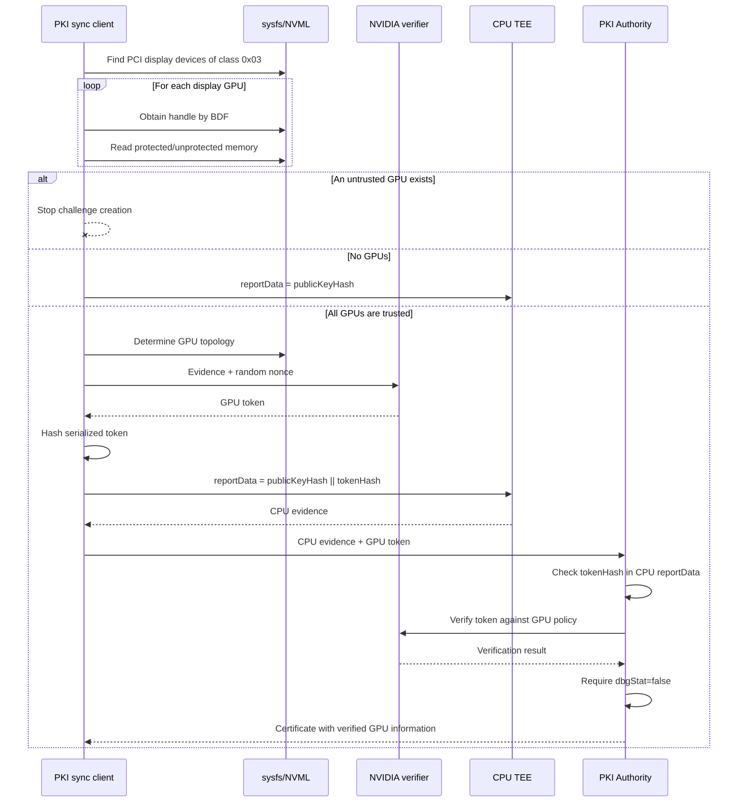

# 5. NVIDIA GPU Attestation

## Role of GPU Attestation

The CPU TEE protects VM memory and execution but does not prove the state of an
attached accelerator. NVIDIA GPUs undergo a separate verification process. Its
result is bound to the CPU quote/report so that the certificate describes one
consistent combination of CPU TEE, node key, and GPU.

GPU verification is performed for TDX, cloud TDX, and SEV-SNP challenges. If no
GPU is present, CPU-only attestation remains valid.

## Boot-Time GPU Readiness

A single image serves both GPU and CPU-only VMs, so the boot path decides at
runtime whether NVIDIA bring-up applies at all. `sp-nvidia-gpu-present` answers
that question from PCI topology alone, using the same criterion as the
verification path below — vendor `0x10de` combined with a `0x03` class prefix.
The vendor check is what separates a real GPU from the hypervisor's emulated
VGA.

On a VM without a GPU, `sp-nvidia-gpu-ready.service` — the barrier that
`pki-cert-init` and `pki-authority-sync` order themselves after — succeeds
immediately, and the NVIDIA units (`nvidia-persistenced`, `nvidia-imex`,
`nvidia-cdi-refresh`) are skipped through `ExecCondition`, so they end up
inactive rather than failed. The absence of a GPU therefore never blocks
certificate initialization or node join.

Detection is deliberately independent of the driver. On a node where a GPU is
physically present but the driver, the persistence daemon, or confidential-
compute setup did not come up, the barrier still fails loudly instead of
degrading the node to CPU-only attestation.

### The barrier is a health publisher

The barrier is `Type=oneshot` with no `Restart=`, so both of its failure paths
are failures **no retry can fix**: systemd will not run it again, and without it
`pki-cert-init` and `pki-authority-sync` never start. Each writes
`/run/sp-health/sp-nvidia-gpu-ready.json` in the `sp.unit-health/v1` format with
`state: failed`, `terminal: true` and a reason class from a closed set —
`fabricmanager-timeout` (Fabric Manager not active within
`SP_NVIDIA_READY_TIMEOUT`, 1200 s by default) or `persistenced-failed`
(`nvidia-persistenced` did not establish CC readiness in three attempts). It
also publishes `attempting` while it waits, `ok` with `gpu-ready` on success,
and `ok` with `no-gpu` on a CPU-only VM — because "no GPU to wait for" and "the
GPU is still coming up" are different facts and only one of them is a reason to
keep waiting.

`ttl_sec` is twice the barrier's own bound (2400 s), so a record from a node
fifteen minutes into GPU bring-up still reads as fresh. Nothing device-specific
is published: no PCI addresses, no device names, no `nvidia-smi` output. The
record is served off the node on an unauthenticated port, and its `reason` is
composed from publisher-authored templates, never captured from a tool.

### Why `:9180` is *not* behind the barrier

`pki-vm-measurements.service` used to carry
`Requires=sp-nvidia-gpu-ready.service`, and the barrier named it in its own
`Before=`. That made the health surface sit behind the thing it reports on: on a
GPU node whose GPU never came ready, the barrier exited 1 and
`pki-vm-measurements` **never started at all** — no `:9180`, no `/healthcheck`,
no node health, permanently, on exactly the node class node health exists for.

Nothing in that process needs the barrier. Every `getMeasure` path reads only
`/dev/tdx_guest` or `/dev/sev-guest` through `@super-protocol/addons-tee`;
`packages/pki-vm-measurements/src/` contains no reference to NVIDIA, the GPU or
`/run/sp-nvidia/cc-ready`, and `cc-ready` is written by
`sp-nvidia-enable-cc-ready` and read only by the barrier itself. So the
dependency is simply dropped, with no route left needing a readiness gate.

`pki-cert-init` and `pki-authority-sync` keep the barrier: a certificate must
not be issued against hardware whose confidential-computing state is not
established. Reporting is not issuing.

## Complete Flow



## Preliminary Detection of Untrusted GPUs

### Device Discovery

Verification begins by enumerating PCI devices through sysfs, rather than by
reading NVIDIA topology. Every device whose class code begins with:

```text
0x03
```

is selected as a PCI display controller. Diagnostics identify each device as:

```text
<PCI BDF> (<display name>)
```

### Confidential Memory Check

For every device:

1. an NVIDIA handle is requested from NVML by PCI BDF;
2. confidential-compute memory information is requested;
3. both mandatory conditions are applied:

```text
protectedMemSizeKib > 0
unprotectedMemSizeKib == 0
```

A GPU is classified as untrusted when:

- NVML initialization fails;
- no handle can be obtained;
- confidential-memory information cannot be read;
- protected memory has zero size;
- at least one KiB of unprotected memory is available.

Every display GPU is checked. If the state of any device cannot be confirmed
or does not meet the requirements, challenge creation stops. Diagnostics
identify the affected device by BDF. This also applies when one invalid GPU is
present alongside several valid GPUs.

If there are no PCI display devices, the preliminary check succeeds and no
NVIDIA token is created.

## Obtaining the NVIDIA Token

After the preliminary check passes, the number of GPUs is determined. If no
GPUs are present, GPU attestation is skipped. Otherwise:

1. a cryptographically random 32-byte nonce is generated and represented by
   64 hexadecimal characters;
2. the NVIDIA SDK collects GPU evidence;
3. evidence is sent to the remote GPU verifier;
4. the request uses `ppcieMode=false`;
5. an NVIDIA token is returned.

## Binding to the CPU TEE

### Calculating the Hash

The hash is calculated over the serialized NVIDIA token:

```text
tokenHash = SHA-256(serialized NVIDIA token)
```

### Creating `reportData`

```text
baseUserData = SHA-256(DER SubjectPublicKeyInfo)  // 32 bytes
tokenHash    = SHA-256(serialized NVIDIA token)   // 32 bytes

reportData = baseUserData || tokenHash            // 64 bytes
```

`baseUserData` hashes the DER encoding of the certificate's public key, not its
PEM text. The value is passed to the TDX quote generator or SEV-SNP report
generator; on an Azure confidential VM it becomes the HCL `user-data` of the
vTPM evidence ([chapter 8](08-azure-attestation.md#binding-userdata)). If the
final value exceeds 64 bytes, the challenge is not created.

### Verifying the Binding

After CPU evidence verification, the PKI Authority obtains verified
`userData`:

```text
userData[0..31]  = expected public-key hash
userData[32..63] = expected NVIDIA-token hash
```

The Authority serializes the supplied token object again, calculates SHA-256,
and compares it with the second half of `userData`. The first half is then
compared with the public key in the certificate request.

## NVIDIA Verification Policy

The NVIDIA verifier confirms that the token belongs to the same request and
describes a genuine device in an acceptable state. It verifies:

- an overall successful attestation result and a supported token format;
- a matching nonce, which prevents reuse of an old token;
- the GPU attestation-report signature, certificate chain, and the absence of
  certificate revocation indications;
- firmware identity;
- the authenticity of the driver and VBIOS reference descriptions and the
  correspondence of their versions and measurements to the actual GPU;
- the absence of conflicting VBIOS information.

The driver and VBIOS reference descriptions used by the NVIDIA verifier are
called RIMs (Reference Integrity Manifests). If any mandatory condition cannot
be confirmed, or the verifier cannot complete the check, no certificate is
issued.

## Debug-Enabled GPU Rejection

After cryptographic token verification, the following values are extracted
from the verified token data:

- `hwmodel`;
- NVIDIA driver version;
- VBIOS version;
- `dbgstat`.

The trusted network applies an additional rule:

```text
for every GPU: dbgstat == "disabled"
```

Any other value is converted to `dbgStat=true`. If debug mode is enabled on
even one GPU, the challenge is rejected.

## Recording the Result in the Certificate

The following structure is created for every verified GPU:

```text
model
driverVersion
vbios
dbgStat
```

The GPU list is encoded in the compact Protobuf binary format and added to the
certificate through the NVIDIA GPU extension. The extension and its OID are
listed in the consolidated
[Certificate Extensions and OIDs](06-pki.md#certificate-extensions-and-oids)
table.

The extension is created by the PKI component. A client-supplied extension
with the same OID is discarded. If no NVIDIA token is present, the GPU
extension is omitted.

## Decision Table

| State | NVIDIA token | Enrollment result |
|---|---:|---|
| No GPUs | No | Continue with CPU-only attestation. |
| Every GPU uses protected memory exclusively | Yes | Verify the token and continue. |
| `protectedMemSizeKib == 0` | No | Stop: untrusted GPU. |
| `unprotectedMemSizeKib != 0` | No | Stop: untrusted GPU. |
| NVML, handle, or memory query fails | No | Stop: GPU trust cannot be established. |
| NVIDIA verifier cannot confirm mandatory token and GPU properties | Yes | Reject the certificate request. |
| Token hash does not match CPU `reportData` | Yes | Reject: CPU and GPU evidence are not bound. |
| One GPU has `dbgStat=true` | Yes | Reject the entire VM. |
| Multiple GPUs, one untrusted | No | Stop the entire attestation. |
