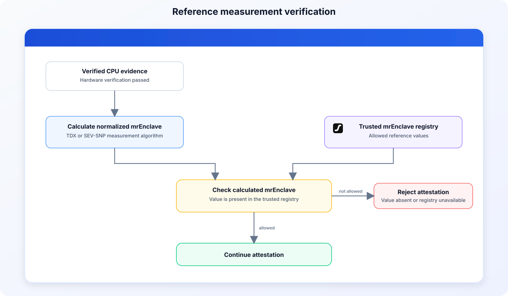

# 7. Reference Measurements

## Purpose of the Registry

The trusted registry contains `mrEnclave` values allowed for use in the
trusted network. It complements hardware evidence verification:

- the hardware verifier confirms the authenticity and validity of CPU
  evidence;
- the registry check confirms that the calculated `mrEnclave` represents an
  approved VM state.

The registry is currently hosted on GitHub. SuperProtocol controls the
addition and publication of reference measurements. Its internal organization
is not part of the attestation protocol.

## Measurement Verification

The verifying party:

1. validates the hardware evidence;
2. calculates a normalized `mrEnclave` according to the applicable hardware
   evidence type;
3. obtains reference data from the trusted registry;
4. confirms that the calculated `mrEnclave` is among the allowed values.

Attestation fails when the corresponding value is absent or the registry is
unavailable.

<!-- Mermaid source: assets/mermaid/reference-measurement-flow.mmd -->

The Intel TDX and AMD SEV-SNP `mrEnclave` calculation algorithms are
described in the [VM measurements chapter](04-vm-measurements.md), and the
Azure confidential VM algorithm in [chapter 8](08-azure-attestation.md).

## External Reference Values

The registry above is specific to the Super Protocol attestation protocol: it
answers "is this `mrEnclave` approved" and nothing else, and reading it means
trusting the Super Protocol signing key.

Every release therefore also publishes its measurements in a standard,
machine-readable form: a **CoRIM** (Concise Reference Integrity Manifest, IETF
RATS; CBOR, COSE_Sign1-signed) attached to the GitHub release of the build,
signed with a dedicated Reference-Values key that is separate from the PKI.

It publishes both spellings of the image identity. The raw hardware
measurements — TDX `TDATTRIBUTES`, `MRTD` and `RTMR1`-`RTMR3`, the SEV-SNP
launch digest, the Azure vTPM `PCR4` and `PCR9` — let an external Verifier such
as Intel Trust Authority match the claims of a quote one by one. The normalised
`mrEnclave` of the registry above, and the normalised `RTMR0` it is computed
over, are published next to them for the swarm verifier and for Veraison. Raw
`RTMR0` is not a reference value and is deliberately absent: it mixes the
dynamic boot events of one VM into the firmware identity, so it differs between
instances of the same release, and only the normalisation of §3 of
[chapter 4](04-vm-measurements.md) identifies the release.

The CoRIM also carries the digests of the build artifacts and the dm-verity
root hash of the rootfs, so a relying party can reproduce every published value
from a rebuild of the image.

The format, the signing key, the verification procedure and the
"rebuild and measure yourself" instructions are documented in
[`reference-values/README.md`](https://github.com/Super-Protocol/sp-vm/blob/main/reference-values/README.md)
of the sp-vm repository.
